# Real-Time Customer Data Integration Pipeline


An end-to-end CDC (change data capture) pipeline: customer and transaction data is streamed
from PostgreSQL through Kafka (Debezium) into Snowflake, then modeled into an
analytics-ready star schema with dbt.

**Stack:** Python · PostgreSQL · Kafka · Debezium · Snowflake · dbt · Docker

## Architecture

```mermaid
flowchart LR
    GEN[Python data generator] -->|INSERT / UPDATE| PG[(PostgreSQL)]
    PG -->|WAL, logical replication| DBZ[Debezium source connector]
    DBZ --> KAFKA[[Kafka topics]]
    KAFKA --> SINK[Snowflake sink connector]
    SINK --> RAW[(Snowflake RAW)]
    RAW --> STG[dbt staging<br/>parse + dedupe]
    STG --> INT[dbt intermediate<br/>enrich]
    INT --> MART[dbt marts<br/>dim / fact / summary]
```



Debezium reads the Postgres write-ahead log instead of polling, so inserts and updates reach
Kafka within seconds. Raw JSON lands in Snowflake VARIANT columns; all typing, deduplication
and validation happens in dbt, where it is version-controlled and tested.

## Results

_Add screenshots here (store them in `docs/images/`):_
Kafka UI topics, connector status, Snowflake RAW tables, `dbt test` output, dbt lineage graph.

## Project structure

```
docker-compose.yml        Postgres, Kafka, Zookeeper, Kafka Connect, Kafka UI, data generator
postgres/init.sql         source schema + CDC publication
producer/                 simulated app traffic (Faker)
kafka-connect/            Debezium source + Snowflake sink connector configs
snowflake/setup.sql       warehouse, database, schemas, role, RAW landing tables
dbt/customer_pipeline/    staging -> intermediate -> marts models + tests
scripts/                  connector registration script
```

## How to run

Prerequisites: Docker Desktop, a Snowflake account (free trial works), Python 3.9+, `openssl`.

1. **Generate a key pair** for the Snowflake service user:
   ```bash
   openssl genrsa 2048 | openssl pkcs8 -topk8 -inform PEM -out snowflake/rsa_key.p8 -nocrypt
   openssl rsa -in snowflake/rsa_key.p8 -pubout -out snowflake/rsa_key.pub
   ```
2. **Set up Snowflake:** run `snowflake/setup.sql` in a worksheet, then run
   `ALTER USER PIPELINE_SVC_USER SET RSA_PUBLIC_KEY='<contents of rsa_key.pub without header/footer>';`
3. **Configure:** `cp .env.example .env`, then fill in the `SNOWFLAKE_*` values.
   `SNOWFLAKE_PRIVATE_KEY` is the contents of `rsa_key.p8` without header/footer, on a single line.
4. **Start the stack:** `make up`
5. **Register connectors:** `make register-connectors`
6. **Run dbt:**
   ```bash
   pip install dbt-snowflake
   export $(grep -v '^#' .env | xargs)
   mkdir -p ~/.dbt && cp dbt/customer_pipeline/profiles.yml.example ~/.dbt/profiles.yml
   make dbt-deps && make dbt-run && make dbt-test
   ```

Useful: Kafka UI at http://localhost:8080, connector status at http://localhost:8083/connectors?expand=status.

## Data model

| Model | Purpose |
|---|---|
| `stg_customers`, `stg_transactions` | parse raw JSON, dedupe CDC events by latest Kafka offset |
| `int_transactions_enriched` | join customer attributes, signed `net_amount` for refunds |
| `dim_customers` | customer dimension |
| `fct_transactions` | transaction fact table |
| `customer_transaction_summary` | lifetime spend, transaction count, active / at_risk / dormant status |

Tests: unique/not-null keys, dim-to-fact relationship, accepted values, and a custom check
that completed purchases are never non-positive.

## Design notes

- **Delivery semantics:** Kafka Connect is at-least-once; offset-based dedup in staging makes replays safe.
- **Schema evolution:** raw VARIANT absorbs new columns; staging selects fields explicitly so breaking changes surface in dbt.
- **Dead-lettering:** malformed messages go to the `snowflake-sink-dlq` topic instead of halting the sink.
- **Local vs production:** single-broker Kafka is for development; production would use a managed, replicated cluster.
